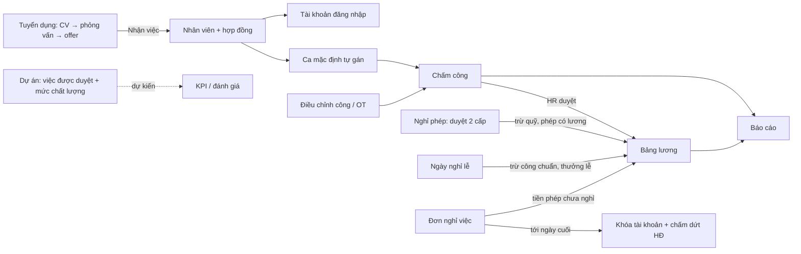

# Bản đồ mã nguồn QLNS

Sổ tay vị trí code: mỗi chức năng nằm ở màn hình nào, API nào, file nào, và những ràng buộc cần nhớ khi sửa.
Theo yêu cầu [`docs/YEU_CAU_DU_AN_QLNS.html`](docs/YEU_CAU_DU_AN_QLNS.html) mục 6.1 (bảng chỉ mục tính năng). Cập nhật đến **19/10/2026**.

**Đi nhanh:** [Bắt đầu nhanh](#bat-dau-nhanh) · [Chọn module](#chon-module) · [Luồng liên module](#luong-lien-module) · [Tra lỗi theo triệu chứng](#tra-loi) · [Lịch chạy tự động](#lich-tu-dong) · [Quy ước cập nhật](#quy-uoc)

> - Nếu file này khác code, tin code: [`routes/api/v1/`](routes/api/v1), [`router/index.js`](resources/js/router/index.js), [`routes/channels.php`](routes/channels.php).
> - Lý do quyết định, quy tắc chi tiết, lỗi đã gặp và lịch sử thay đổi nằm ở [`docs/CODE_MAP_LICH_SU.md`](docs/CODE_MAP_LICH_SU.md). Comment trong code ghi "**mục N CODE_MAP**" là trỏ tới **mục N của file đó**.

<a id="bat-dau-nhanh"></a>

## Bắt đầu nhanh

| Bạn đang cần | Bắt đầu từ |
| --- | --- |
| Chạy dự án trên máy | [`README.md`](README.md), [`docs/LOCAL_DEVELOPMENT.md`](docs/LOCAL_DEVELOPMENT.md) |
| Hiểu một yêu cầu đi qua code thế nào | [Đường đi của một yêu cầu](#duong-di) |
| Thêm một chức năng mới | [Thêm chức năng mới](#them-chuc-nang) |
| Đã biết màn hình / phân hệ cần sửa | [Chọn module](#chon-module) |
| Sửa ở module này nhưng lỗi hiện ở module khác | [Luồng liên module](#luong-lien-module) |
| Đang gặp lỗi, chưa rõ nguyên nhân | [Tra lỗi theo triệu chứng](#tra-loi) |
| Quy chuẩn đặt tên, cấu trúc code | [`docs/CODING_STANDARDS.md`](docs/CODING_STANDARDS.md) |

<a id="duong-di"></a>

### Đường đi của một yêu cầu

```
Màn hình Vue → services/*.js (axios) → routes/api/v1/*.php → auth:api → permission:<mã quyền>
→ FormRequest (validate) → Controller → Service (quy tắc nghiệp vụ) → Repository/Model → Resource (JSON)
```

Ví dụ "Thêm nhân viên": [`Employees.vue`](resources/js/views/Employee/Employees.vue) → [`EmployeeForm.vue`](resources/js/views/Employee/EmployeeForm.vue) → [`useEmployeeStore.js`](resources/js/stores/useEmployeeStore.js) → [`employees.php`](routes/api/v1/employees.php) (`permission:employee.create`) → [`StoreEmployeeRequest`](app/Http/Requests/Employee/StoreEmployeeRequest.php) → [`EmployeeController`](app/Http/Controllers/Api/V1/EmployeeController.php) → [`EmployeeService::create()`](app/Services/EmployeeService.php) → [`EmployeeResource`](app/Http/Resources/EmployeeResource.php).
Yêu cầu dừng sớm ở 4 chỗ: validate phía client, sai token (401), thiếu quyền (403), dữ liệu sai (422).

<a id="them-chuc-nang"></a>

### Thêm chức năng mới

- **Backend** (mẫu gọn nhất: Chức vụ): migration → Model (`$fillable`, quan hệ, `use Auditable;`) → Request → Repository → Service → Controller → route + `permission:` → Resource → test ở `tests/Feature/<Module>/`.
- **Frontend:** `services/xxxService.js` → (Pinia store nếu nhiều trang dùng) → view dùng [`DataTable`](resources/js/components/common/DataTable.vue) / [`FormDialog`](resources/js/components/common/FormDialog.vue) → route trong [`router/index.js`](resources/js/router/index.js) có `meta.title` + `meta.permission` → mục menu ở [`AppSidebar.vue`](resources/js/components/layout/AppSidebar.vue) + [`QuickSearch.vue`](resources/js/components/layout/QuickSearch.vue).
- **Muốn trang tự làm mới khi người khác sửa:** trait `BroadcastsChanges` trên model + khai resource trong [`routes/channels.php`](routes/channels.php) + `useRealtimeRefresh()` ở trang (xem [Realtime](#m-realtime)).
- **Có thông báo mới:** `NotificationService::send()` + khai `type` ở 3 file giao diện (xem [Thông báo](#m-thong-bao)).
- Đổi luồng người dùng thao tác → sửa bài tương ứng trong [`content/userGuide.js`](resources/js/content/userGuide.js).
- Cập nhật dòng của module trong file này.

<a id="chon-module"></a>

## Chọn module

| Module | Màn hình | Giao diện Frontend | Xử lý Backend | CSDL & API |
| --- | --- | --- | --- | --- |
| [Xác thực & bảo mật](#m-xac-thuc) | `/dang-nhap`, `/quen-mat-khau` | [`Login.vue`](resources/js/views/Login.vue), [`authStore.js`](resources/js/stores/authStore.js) | [`AuthService`](app/Services/AuthService.php), [`LoginLockoutService`](app/Services/LoginLockoutService.php) | `users`, `refresh_tokens` · [`auth.php`](routes/api/v1/auth.php) |
| [Phân quyền](#m-phan-quyen) | `/vai-tro-va-phan-quyen` | [`views/Role/`](resources/js/views/Role) | [`RoleService`](app/Services/RoleService.php), [`EnsurePermission`](app/Http/Middleware/EnsurePermission.php) | `roles`, `permissions` · [`roles.php`](routes/api/v1/roles.php) |
| [Khung ứng dụng](#m-khung) | Sidebar, Header, Ctrl+K, `/huong-dan-su-dung` | [`components/layout/`](resources/js/components/layout), [`UserGuide.vue`](resources/js/views/UserGuide.vue) | [`SearchService`](app/Services/SearchService.php) | [`search.php`](routes/api/v1/search.php) |
| [Tổng quan](#m-tong-quan) | `/` | [`Dashboard.vue`](resources/js/views/Dashboard.vue) | [`DashboardService`](app/Services/DashboardService.php) | [`dashboard.php`](routes/api/v1/dashboard.php) |
| [Phòng ban & Chức vụ](#m-phong-ban) | `/phong-ban`, `/chuc-vu` | [`views/Department/`](resources/js/views/Department), [`views/Position/`](resources/js/views/Position) | [`DepartmentService`](app/Services/DepartmentService.php), [`ReportingLineService`](app/Services/ReportingLineService.php) | `departments`, `positions` · [`departments.php`](routes/api/v1/departments.php) |
| [Nhân viên](#m-nhan-vien) | `/nhan-vien`, `/nhan-vien/:id` | [`views/Employee/`](resources/js/views/Employee) | [`EmployeeService`](app/Services/EmployeeService.php), [`EmployeeContractService`](app/Services/EmployeeContractService.php) | `employees`, `employee_contracts` · [`employees.php`](routes/api/v1/employees.php) |
| [Hồ sơ của tôi](#m-ho-so) | `/ho-so-cua-toi` | [`views/Me/`](resources/js/views/Me) | `mine()` ở các Controller nhân viên | `/employees/me/*` |
| [Ca làm việc](#m-ca) | `/ca-lam-viec`, `/cai-dat-he-thong` | [`views/WorkShift/`](resources/js/views/WorkShift), [`Settings.vue`](resources/js/views/Settings/Settings.vue) | [`WorkShiftService`](app/Services/WorkShiftService.php), [`EmployeeShiftAssignmentService`](app/Services/EmployeeShiftAssignmentService.php) | `work_shifts` · [`work-shifts.php`](routes/api/v1/work-shifts.php) |
| [Chấm công](#m-cham-cong) | `/cham-cong`, `/tong-hop-cham-cong`, `/lich-su-cham-cong` | [`views/Attendance/`](resources/js/views/Attendance), [`useCheckIn.js`](resources/js/composables/useCheckIn.js) | [`AttendanceService`](app/Services/AttendanceService.php), [`WorkTimeCalculationService`](app/Services/WorkTimeCalculationService.php) | `attendances`, `attendance_logs` · [`attendances.php`](routes/api/v1/attendances.php) |
| [Điều chỉnh công & OT](#m-dieu-chinh) | `/cham-cong`, `/duyet-dieu-chinh-cong` | [`AttendanceAdjustments.vue`](resources/js/views/Attendance/AttendanceAdjustments.vue) | [`AttendanceAdjustmentService`](app/Services/AttendanceAdjustmentService.php) | `attendance_adjustments` |
| [Nghỉ phép](#m-nghi-phep) | `/nghi-phep`, `/duyet-nghi-phep`, `/tong-hop-nghi-phep` | [`views/Leave/`](resources/js/views/Leave) | [`LeaveRequestService`](app/Services/LeaveRequestService.php), [`LeaveApprovalService`](app/Services/LeaveApprovalService.php), [`LeaveBalanceService`](app/Services/LeaveBalanceService.php) | `leave_*` · [`leave-requests.php`](routes/api/v1/leave-requests.php) |
| [Ngày nghỉ lễ](#m-ngay-le) | `/ngay-nghi-le` | [`views/Holiday/`](resources/js/views/Holiday) | [`HolidayService`](app/Services/HolidayService.php), [`LunarCalendar`](app/Support/LunarCalendar.php) | `holidays`, `holiday_rules` · [`holidays.php`](routes/api/v1/holidays.php) |
| [Bảng lương & phụ cấp](#m-luong) | `/bang-luong`, `/bang-luong/:id`, `/phu-cap` | [`views/Payroll/`](resources/js/views/Payroll) | [`PayrollService`](app/Services/PayrollService.php), [`AllowanceService`](app/Services/AllowanceService.php), [`Services/Payroll/`](app/Services/Payroll) | `payrolls`, `payroll_details`, `employee_allowances` · [`payrolls.php`](routes/api/v1/payrolls.php), [`allowances.php`](routes/api/v1/allowances.php) |
| [Báo cáo](#m-bao-cao) | `/bao-cao` | [`views/Report/`](resources/js/views/Report) | [`ReportService`](app/Services/ReportService.php) | [`reports.php`](routes/api/v1/reports.php) |
| [Tuyển dụng](#m-tuyen-dung) | `/tuyen-dung`, `/lich-phong-van`, `/bo-cau-hoi-phong-van`, `/bao-cao-tuyen-dung` | [`views/Recruitment/`](resources/js/views/Recruitment) | [`RecruitmentService`](app/Services/RecruitmentService.php) và 4 service `Recruitment*`/`InterviewScorecard*` | `recruitment_*`, `interview_*` · [`recruitment.php`](routes/api/v1/recruitment.php) |
| [Đơn nghỉ việc](#m-nghi-viec) | `/don-nghi-viec`, Hồ sơ của tôi | [`Resignations.vue`](resources/js/views/Resignation/Resignations.vue) | [`ResignationService`](app/Services/ResignationService.php) | `resignation_requests` · [`resignations.php`](routes/api/v1/resignations.php) |
| [Dự án, công việc & KPI](#m-du-an) | `/du-an`, `/du-an/:id`, `/cong-viec-cua-toi`, `/kpi` | [`views/Project/`](resources/js/views/Project) | [`ProjectService`](app/Services/ProjectService.php), [`ProjectTaskService`](app/Services/ProjectTaskService.php), [`KpiService`](app/Services/KpiService.php) | `projects`, `project_tasks`, `kpi_monthly_results` · [`projects.php`](routes/api/v1/projects.php), [`kpi.php`](routes/api/v1/kpi.php) |
| [Thông báo](#m-thong-bao) | Chuông, `/thong-bao` | [`NotificationCenter.vue`](resources/js/components/layout/NotificationCenter.vue), [`Notifications.vue`](resources/js/views/Notification/Notifications.vue) | [`NotificationService`](app/Services/NotificationService.php) | `notifications` · [`notifications.php`](routes/api/v1/notifications.php) |
| [Realtime](#m-realtime) | Toàn hệ thống | [`echo.js`](resources/js/echo.js), [`useRealtimeRefresh.js`](resources/js/composables/useRealtimeRefresh.js) | [`BroadcastsChanges`](app/Models/Concerns/BroadcastsChanges.php), [`Realtime`](app/Support/Realtime.php) | [`routes/channels.php`](routes/channels.php) |
| [Nhật ký hoạt động](#m-nhat-ky) | `/nhat-ky-hoat-dong` | [`AuditLogViewer.vue`](resources/js/views/AuditLogViewer.vue) | [`AuditObserver`](app/Observers/AuditObserver.php), [`LogService`](app/Services/LogService.php) | `audit_logs` · [`logs.php`](routes/api/v1/logs.php) |
| [Thành phần dùng chung](#m-dung-chung) | Mọi trang | [`components/common/`](resources/js/components/common), [`composables/`](resources/js/composables) | — | — |
| [Hạ tầng & công cụ](#m-ha-tang) | — | [`vite.config.js`](vite.config.js) | [`docker/`](docker), [`.github/workflows/ci.yml`](.github/workflows/ci.yml) | — |

<a id="luong-lien-module"></a>

## Luồng liên module

Lỗi thường hiện ở module sau nhưng nguyên nhân nằm ở bước trước. Ví dụ: lương của một người thiếu công, nhưng gốc là chấm công chưa được duyệt.



<a id="tra-loi"></a>

## Tra lỗi theo triệu chứng

| Triệu chứng | Kiểm tra theo thứ tự | Điểm vào |
| --- | --- | --- |
| Lương thiếu ngày công | Bản ghi chấm công đã duyệt chưa (cả giờ vào lẫn giờ ra) → ca có bị xóa → đi muộn/về sớm quá 30 phút → bảng lương tạo trước khi duyệt? | Nút "Kiểm tra ngày công" ở chi tiết bảng lương, [`PayrollService::workdayBreakdown()`](app/Services/PayrollService.php) |
| OT không được trả | Đã xin duyệt OT chưa (`overtime_approved`) → đủ 25 phút sau ân hạn chưa | [`PayrollService`](app/Services/PayrollService.php), [Điều chỉnh công](#m-dieu-chinh) |
| Không bấm chấm công được | Hôm nay có ca không (T7/CN ngoài `work_days`) → ngoài khung giờ (sớm hơn 30 phút / sau giờ ra) → nhân viên chưa có bản gán ca | [`AttendanceService::checkIn()`](app/Services/AttendanceService.php), [Ca làm việc](#m-ca) |
| Đơn nghỉ phép báo hết quỹ | Số dư = cấp + chuyển + điều chỉnh − đã dùng − đơn đang chờ; năm đầu tích lũy 30 ngày được 1 ngày | [`LeaveBalanceService`](app/Services/LeaveBalanceService.php), [`LeaveAccrualService`](app/Services/LeaveAccrualService.php) |
| Đơn nghỉ phép không tới đúng người duyệt | Quản lý trực tiếp = Trưởng phòng (tự suy từ cây phòng ban); không có thì đi thẳng HR | [`ReportingLineService`](app/Services/ReportingLineService.php) |
| Trang không tự cập nhật khi người khác sửa | Model có trait chưa → resource có trong `channels.php` chưa (thiếu là 403 im lặng) → trang có `useRealtimeRefresh` chưa → Reverb có chạy không | [Realtime](#m-realtime) |
| Bấm thông báo không mở đúng trang | `type` đã khai ở `useNotificationNavigation.js` chưa | [Thông báo](#m-thong-bao) |
| Thiếu quyền dù đã cấp | Quyền cache 60 giây; route có gắn `permission:` đúng mã chưa | [Phân quyền](#m-phan-quyen) |
| Lịch tự động (nhắc, hết hạn HĐ, thông báo lễ) không chạy | Container `scheduler` có đang chạy không | [Lịch chạy tự động](#lich-tu-dong) |
| Mở trang lần đầu bị đứng / tải lại nhiều lần (khi `npm run dev`) | Vite vừa khởi động còn đang biên dịch (`server.warmup`) → bộ đệm thư viện (`optimizeDeps`) → `npm run dev` đã chạy lại sau khi sửa `vite.config.js` chưa | [Hạ tầng & công cụ](#m-ha-tang) |
| Sáng mở trang bị đẩy ra đăng nhập dù chưa hết 7 ngày | Access token hết hạn qua đêm là bình thường (tự làm mới); bị đẩy ra là do refresh token bị thu hồi — xem `refresh_tokens` (`revoked_at`, `rotated_at`) | [Xác thực](#m-xac-thuc) |

---

<a id="m-xac-thuc"></a>

## 1. Xác thực & bảo mật

**Vai trò:** đăng nhập JWT, làm mới token, quên/đặt lại mật khẩu, tự khóa tài khoản khi đoán mật khẩu, giới hạn số lần gọi API.

- **Frontend:** [`Login.vue`](resources/js/views/Login.vue), [`ForgotPassword.vue`](resources/js/views/ForgotPassword.vue), [`ResetPassword.vue`](resources/js/views/ResetPassword.vue), [`authStore.js`](resources/js/stores/authStore.js), làm mới token tự động ở [`bootstrap.js`](resources/js/bootstrap.js).
- **Backend:** [`AuthController`](app/Http/Controllers/Api/V1/AuthController.php), [`AuthService`](app/Services/AuthService.php), [`PasswordResetService`](app/Services/PasswordResetService.php), [`LoginLockoutService`](app/Services/LoginLockoutService.php), [`Jwt/JwtService`](app/Services/Jwt/JwtService.php), [`Auth/JwtGuard`](app/Auth/JwtGuard.php); giới hạn số lần gọi ở [`AppServiceProvider`](app/Providers/AppServiceProvider.php) + [`config/rate_limits.php`](config/rate_limits.php).
- **Dữ liệu & API:** `users`, `refresh_tokens`, `password_reset_tokens`, `password_histories` · [`auth.php`](routes/api/v1/auth.php).
- **Kiểm thử:** [`tests/Feature/Auth/`](tests/Feature/Auth), [`AccountLockoutTest`](tests/Feature/Security/AccountLockoutTest.php), [`HardeningTest`](tests/Feature/Security/HardeningTest.php).
- **Ràng buộc khi sửa:**
  - Refresh token xoay vòng, dùng 1 lần; nhiều tab phối hợp qua khóa `navigator.locks`. Token vừa xoay vòng được dùng lại trong `AuthService::ROTATION_GRACE_SECONDS` (30 giây) để F5 đúng lúc đang làm mới không bị đẩy ra đăng nhập (`refresh_tokens.rotated_at`, `replaced_by_id`); thu hồi vì bảo mật (đăng xuất, đổi mật khẩu, khóa tài khoản) thì không có ân hạn.
  - `JwtGuard` kiểm `users.status` mỗi request: khóa tài khoản là có hiệu lực ngay.
  - Quên mật khẩu luôn trả thành công (chống dò email). Sai 10 lần/15 phút theo email → khóa 15 phút + email báo chủ tài khoản.
- **Lịch sử:** mục 1, 57 trong [`CODE_MAP_LICH_SU.md`](docs/CODE_MAP_LICH_SU.md).

<a id="m-phan-quyen"></a>

## 2. Phân quyền

**Vai trò:** vai trò, quyền, ma trận gán quyền, cấp bậc vai trò (chặn gán vai trò cao hơn mình).

- **Frontend:** [`Roles.vue`](resources/js/views/Role/Roles.vue), [`RoleForm.vue`](resources/js/views/Role/RoleForm.vue), [`RolePermissionsDialog.vue`](resources/js/views/Role/RolePermissionsDialog.vue), [`roleLevels.js`](resources/js/composables/roleLevels.js). Menu và route ẩn theo `can()` / `meta.permission` (chỉ là lớp giao diện).
- **Backend:** [`EnsurePermission`](app/Http/Middleware/EnsurePermission.php) (`permission:` trên route), [`RoleService`](app/Services/RoleService.php), [`PermissionService`](app/Services/PermissionService.php), [`Role`](app/Models/Role.php) (`LEVELS`, `SYSTEM_ADMIN`).
- **Dữ liệu & API:** `roles`, `permissions`, `role_permissions`, `user_roles` · [`roles.php`](routes/api/v1/roles.php), [`permissions.php`](routes/api/v1/permissions.php) · seed: [`PermissionSeeder`](database/seeders/PermissionSeeder.php), [`RolePermissionSeeder`](database/seeders/RolePermissionSeeder.php).
- **Kiểm thử:** [`tests/Feature/Role/`](tests/Feature/Role), [`PermissionCrudTest`](tests/Feature/Permission/PermissionCrudTest.php), [`PermissionMiddlewareTest`](tests/Feature/PermissionMiddlewareTest.php).
- **Ràng buộc khi sửa:**
  - Admin là vai trò hệ thống: luôn có mọi quyền, không sửa quyền, không xóa được.
  - Chỉ gán được vai trò có cấp **thấp hơn** cấp cao nhất của mình (Admin 100 · HR 60 · Manager 40 · Employee 20 · Intern 0). Thêm bậc mới phải sửa cả `Role::LEVELS` lẫn `roleLevels.js`.
  - Quyền mới tạo chưa khóa API nào cho tới khi gắn `permission:<mã>` vào route.
  - Không chạy lại `RolePermissionSeeder` trên DB thật (seeder xóa quyền không có trong danh sách); thêm quyền bằng migration chỉ-thêm.
- **Lịch sử:** mục 2, 59.

<a id="m-khung"></a>

## 3. Khung ứng dụng: layout, menu, tìm nhanh, hướng dẫn

**Vai trò:** khung trang, sidebar nhóm đóng/mở, tìm nhanh và lệnh nhanh Ctrl+K, trang Hướng dẫn sử dụng.

- **Frontend:** [`App.vue`](resources/js/App.vue), [`AppLayout.vue`](resources/js/components/layout/AppLayout.vue), [`AppHeader.vue`](resources/js/components/layout/AppHeader.vue), [`AppSidebar.vue`](resources/js/components/layout/AppSidebar.vue) (mảng `menu`), [`QuickSearch.vue`](resources/js/components/layout/QuickSearch.vue) (`ALL_ITEMS`, `COMMANDS`), [`useRouteAction.js`](resources/js/composables/useRouteAction.js) (`?action=` mở sẵn hộp thoại), theme ở [`plugins/vuetify.js`](resources/js/plugins/vuetify.js). Hướng dẫn: [`UserGuide.vue`](resources/js/views/UserGuide.vue) + nội dung [`content/userGuide.js`](resources/js/content/userGuide.js).
- **Backend:** [`SearchService`](app/Services/SearchService.php) — tìm nhân viên cho Ctrl+K (`GET /search?q=`).
- **Kiểm thử:** [`SearchTest`](tests/Feature/SearchTest.php).
- **Ràng buộc khi sửa:**
  - Thêm trang mới phải thêm ở 3 nơi: route, `menu` của sidebar, `ALL_ITEMS` của Ctrl+K.
  - Đổi luồng nghiệp vụ thì sửa bài tương ứng trong `userGuide.js`.
- **Lịch sử:** mục 4, 26, 38, 39, 63, 72.

<a id="m-tong-quan"></a>

## 4. Tổng quan (Dashboard)

**Vai trò:** số liệu công ty (HR/Manager), phần "Của tôi" (chấm công hôm nay, công tháng, lương gần nhất), "Cần bạn xử lý", việc dự án, ngày lễ sắp tới.

- **Frontend:** [`Dashboard.vue`](resources/js/views/Dashboard.vue), [`components/dashboard/`](resources/js/components/dashboard).
- **Backend:** [`DashboardService`](app/Services/DashboardService.php) (`companyWide()`, `personal()`, `actionItems()`, `shared()`), [`ProjectDashboardService`](app/Services/ProjectDashboardService.php).
- **Dữ liệu & API:** không có bảng riêng · `GET /dashboard?date=`.
- **Kiểm thử:** [`DashboardTest`](tests/Feature/DashboardTest.php), [`ProjectDashboardTest`](tests/Feature/Project/ProjectDashboardTest.php).
- **Ràng buộc khi sửa:** có `employee.view` → phạm vi công ty, không có → cá nhân. Mỗi mục "Cần bạn xử lý" tự lọc theo quyền. Tỷ lệ đi làm ở đây là số xấp xỉ, số chính thức xem [Báo cáo](#m-bao-cao).
- **Lịch sử:** mục 5, 35, 37, 69.

<a id="m-phong-ban"></a>

## 5. Phòng ban & Chức vụ

**Vai trò:** cây phòng ban, Trưởng phòng, chức vụ; tự suy ra quản lý trực tiếp của mọi nhân viên.

- **Frontend:** [`Departments.vue`](resources/js/views/Department/Departments.vue), [`DepartmentForm.vue`](resources/js/views/Department/DepartmentForm.vue), [`Positions.vue`](resources/js/views/Position/Positions.vue), [`PositionForm.vue`](resources/js/views/Position/PositionForm.vue).
- **Backend:** [`DepartmentService`](app/Services/DepartmentService.php) (`syncHeadPosition()`), [`PositionService`](app/Services/PositionService.php), [`ReportingLineService`](app/Services/ReportingLineService.php).
- **Dữ liệu & API:** `departments`, `positions`, `role_positions` · [`departments.php`](routes/api/v1/departments.php), [`positions.php`](routes/api/v1/positions.php) · quyền `department.view` / `department.manage` (Chức vụ dùng chung).
- **Kiểm thử:** [`DepartmentTest`](tests/Feature/Department/DepartmentTest.php), [`PositionTest`](tests/Feature/Position/PositionTest.php).
- **Ràng buộc khi sửa:**
  - Quản lý trực tiếp = Trưởng phòng của phòng nhân viên; Trưởng phòng thì lấy Trưởng phòng phòng cha. Client không gửi `manager_id`; dữ liệu cũ đồng bộ bằng `employees:sync-managers`.
  - Hai chức vụ hệ thống (`type = head / default`) không sửa/xóa được. Không xóa phòng ban còn phòng con.
  - Chức vụ không có phụ cấp (đã bỏ cột `position_allowance`); phụ cấp đặt ở trang Phụ cấp, xem [mục 13](#m-luong).
- **Lịch sử:** mục 6, 7, 47.

<a id="m-nhan-vien"></a>

## 6. Nhân viên

**Vai trò:** hồ sơ, hợp đồng, tài liệu, điều chuyển, gán ca, tài khoản đăng nhập, tài khoản ngân hàng, hành trình (tuyển dụng → lương → dự án & KPI → chuyên cần, phụ cấp).

- **Frontend:** [`Employees.vue`](resources/js/views/Employee/Employees.vue), [`EmployeeForm.vue`](resources/js/views/Employee/EmployeeForm.vue), [`EmployeeDetail.vue`](resources/js/views/Employee/EmployeeDetail.vue) + các tab `Employee*Tab.vue` (nhận `?tab=`), [`EmployeeQuickView.vue`](resources/js/views/Employee/EmployeeQuickView.vue), [`components/employee/`](resources/js/components/employee), nhãn ở [`employmentStatus.js`](resources/js/composables/employmentStatus.js), [`transferTypes.js`](resources/js/composables/transferTypes.js), [`employeeAlerts.js`](resources/js/composables/employeeAlerts.js).
- **Backend:** [`EmployeeService`](app/Services/EmployeeService.php), [`EmployeeContractService`](app/Services/EmployeeContractService.php), [`EmployeeDocumentService`](app/Services/EmployeeDocumentService.php), [`EmployeeTransferService`](app/Services/EmployeeTransferService.php), [`EmployeeAccountService`](app/Services/EmployeeAccountService.php), [`EmployeeBankAccountService`](app/Services/EmployeeBankAccountService.php), [`EmployeeJourneyService`](app/Services/EmployeeJourneyService.php); địa chỉ Tỉnh/Xã: [`AddressController`](app/Http/Controllers/Api/V1/AddressController.php).
- **Dữ liệu & API:** `employees`, `employee_contracts`, `employee_documents`, `employee_transfers`, `employee_bank_accounts`, `provinces`, `communes` · [`employees.php`](routes/api/v1/employees.php), [`addresses.php`](routes/api/v1/addresses.php) · quyền `employee.view/create/update/delete`, `employee.journey`.
- **Kiểm thử:** [`tests/Feature/Employee/`](tests/Feature/Employee), [`tests/Feature/Console/`](tests/Feature/Console) (hợp đồng hết hạn / bắt đầu hiệu lực).
- **Ràng buộc khi sửa:**
  - Tạo nhân viên trong 1 transaction: hồ sơ + hợp đồng đầu tiên + ca mặc định + dòng "Tiếp nhận"; trạng thái nhân viên suy từ loại hợp đồng (thử việc / chính thức / thực tập).
  - Không sửa lương trong hồ sơ: đổi lương = ký hợp đồng mới. Hợp đồng chỉ "bổ sung" ô còn trống; thay tệp PDF bắt buộc lý do và giữ tệp cũ. Lương khác hợp đồng trước → bắt buộc `salary_change_note` (lý do tăng/giảm, 2026-10-22); hợp đồng cũ chưa ghi thì bổ sung qua "Bổ sung dữ liệu còn thiếu".
  - **Tab Hành trình** = lộ trình 1 trang (2026-10-22): 6 ô tóm tắt đầu trang (Thâm niên, Tuyển dụng, Lương, KPI dự án, Chuyên cần, Phụ cấp — số chính + nhãn màu kết luận, dựng ở `EmployeeJourneyTab.vue` từ dữ liệu API; KPI tổng = `kpi.overall`), phỏng vấn (điểm từng phần, lý do kết quả, nhận xét phiếu chấm), "Diễn biến lương" = bậc lương theo hợp đồng ([`SalaryLadder.vue`](resources/js/components/employee/SalaryLadder.vue): cao thấp theo mức lương, +/−%, lý do) + cột thực nhận từng tháng kèm đường lương hợp đồng ([`SalaryJourneyChart.vue`](resources/js/components/employee/SalaryJourneyChart.vue), rê chuột xem công/phụ cấp/khấu trừ), dự án & KPI (`KpiService::employeeHistory()`, đạt = xếp loại A/B/C), chuyên cần 12 tháng gần nhất (dùng `AttendanceService::history()` — dựng từng ngày nên không lặp cả thâm niên), phụ cấp đang hưởng + lịch sử (nhóm "Phụ cấp" ở dòng thời gian), lương thực nhận. Gom từ dữ liệu sẵn có, không bảng riêng. Quyền: `employee.journey` (Admin, HR) hoặc Trưởng phòng của nhân viên (phòng mình + phòng con) — `EmployeeJourneyService::canView()`, API chi tiết nhân viên trả `meta.can_view_journey` để hiện tab.
  - `EmployeeResource` ẩn CCCD, SĐT, lương với cấp dưới. Lọc "đang làm việc" dùng `Employee::WORKING_STATUSES`.
  - Giới hạn tải tệp khai ở `UPLOAD_LIMITS` ([`InputFile.vue`](resources/js/components/common/InputFile.vue)) phải khớp rule `max:` ở backend.
- **Lịch sử:** mục 8, 9, 11, 48, 55, 65, 67.

<a id="m-ho-so"></a>

## 7. Hồ sơ của tôi

**Vai trò:** nhân viên tự xem hồ sơ, hợp đồng, phiếu lương, ca, điều chuyển; tự sửa liên hệ, ảnh đại diện, tài liệu, tài khoản ngân hàng; nộp đơn nghỉ việc.

- **Frontend:** [`MyProfile.vue`](resources/js/views/Me/MyProfile.vue) + các tab `MyProfile*Tab.vue` (nhận `?tab=`).
- **Backend:** `mine()` ở các Controller hợp đồng / tài liệu / ca / điều chuyển, `EmployeeController::updateMine()`, `uploadMyAvatar()`; validate [`UpdateMyProfileRequest`](app/Http/Requests/Employee/UpdateMyProfileRequest.php) (chỉ 5 ô liên hệ).
- **Dữ liệu & API:** `/employees/me/*` — chỉ cần đăng nhập, luôn lấy theo người đang đăng nhập.
- **Ràng buộc khi sửa:** route tải hợp đồng/tài liệu không gắn `permission:`, tự kiểm "chính chủ hoặc có quyền" trong hàm. Route `/me` phải khai **trước** `/{employee}`.
- **Lịch sử:** mục 15, 43, 51.

<a id="m-ca"></a>

## 8. Ca làm việc & ca mặc định

**Vai trò:** danh mục ca, ca mặc định của công ty (giờ vào/ra, nghỉ trưa, ngày làm trong tuần), gán ca riêng cho từng người.

- **Frontend:** [`WorkShifts.vue`](resources/js/views/WorkShift/WorkShifts.vue), [`WorkShiftForm.vue`](resources/js/views/WorkShift/WorkShiftForm.vue), [`Settings.vue`](resources/js/views/Settings/Settings.vue) (ca mặc định), tab ca ở [`EmployeeShiftAssignmentsTab.vue`](resources/js/views/Employee/EmployeeShiftAssignmentsTab.vue).
- **Backend:** [`WorkShiftService`](app/Services/WorkShiftService.php), [`EmployeeShiftAssignmentService`](app/Services/EmployeeShiftAssignmentService.php) (`assignDefaultShift()`, `resyncOpenEndedWorkDays()`).
- **Dữ liệu & API:** `work_shifts` (`is_default`, `work_days`, `is_overtime`), `employee_shift_assignments` · [`work-shifts.php`](routes/api/v1/work-shifts.php) · quyền `shift.view` / `shift.manage`.
- **Kiểm thử:** [`WorkShiftTest`](tests/Feature/WorkShift/WorkShiftTest.php), [`EmployeeShiftAssignmentTest`](tests/Feature/Employee/EmployeeShiftAssignmentTest.php), [`AssignMissingDefaultShiftTest`](tests/Feature/Console/AssignMissingDefaultShiftTest.php).
- **Ràng buộc khi sửa:**
  - Đúng 1 ca mặc định; mọi người dùng ca mặc định trỏ chung 1 `work_shift_id`, đổi giờ là áp cho tất cả.
  - Xóa/tắt ca thì gỡ khỏi mọi bản gán trước (tránh bản gán "mồ côi"). Chưa hỗ trợ ca qua đêm.
- **Lịch sử:** mục 12, 14, 28, 31.

<a id="m-cham-cong"></a>

## 9. Chấm công

**Vai trò:** chấm vào/ra (ghi IP, thiết bị, vị trí), HR duyệt riêng giờ vào và giờ ra, tổng hợp trong ngày, lịch sử theo tháng, xuất bảng chấm công Excel.

- **Frontend:** [`CheckIn.vue`](resources/js/views/Attendance/CheckIn.vue) (chuyển bản desktop/mobile) + [`useCheckIn.js`](resources/js/composables/useCheckIn.js), [`AttendanceOverview.vue`](resources/js/views/Attendance/AttendanceOverview.vue), [`AttendanceHistoryPanel.vue`](resources/js/views/Attendance/AttendanceHistoryPanel.vue), [`AttendanceSheetExportDialog.vue`](resources/js/views/Attendance/AttendanceSheetExportDialog.vue), nhãn trạng thái ở [`attendanceStatus.js`](resources/js/composables/attendanceStatus.js).
- **Backend:** [`AttendanceService`](app/Services/AttendanceService.php) (`checkIn/checkOut`, `decideApproval`, `dailyOverview`, `history`, `displayStatusFor`), [`WorkTimeCalculationService`](app/Services/WorkTimeCalculationService.php) (công 1 ngày, dùng chung với lương), [`AttendanceSheetService`](app/Services/AttendanceSheetService.php) + [`AttendanceSheetExport`](app/Exports/AttendanceSheetExport.php), [`Attendance/ReverseGeocoder`](app/Services/Attendance/ReverseGeocoder.php).
- **Dữ liệu & API:** `attendances` (1 dòng / ca / ngày), `attendance_logs` · [`attendances.php`](routes/api/v1/attendances.php) · quyền `attendance.check`, `view_own`, `view_all`, `approve`.
- **Kiểm thử:** [`tests/Feature/Attendance/`](tests/Feature/Attendance), [`AttendanceServiceCalculationTest`](tests/Unit/Services/AttendanceServiceCalculationTest.php), [`WorkTimeCalculationServiceTest`](tests/Unit/Services/WorkTimeCalculationServiceTest.php).
- **Ràng buộc khi sửa:**
  - Chỉ bản ghi **đã duyệt** mới có công. Chấm ra xong thì giờ ra quay lại "chờ duyệt".
  - Muộn/sớm ≤ 30 phút vẫn đủ công; quá 30 phút tính theo phút làm thực tế. Công 1 ngày tối đa 1,0.
  - Vào sớm tối đa 30 phút trước ca, chặn sau giờ ra. Tra địa chỉ (Nominatim) lỗi vẫn cho chấm công.
  - Khi chấm vào, nhân viên chọn "Tại công ty" (mặc định) / "Làm online" ([`WorkModeToggle.vue`](resources/js/components/attendance/WorkModeToggle.vue)) → `attendances.work_mode`. HR đổi lại ở Tổng hợp chấm công (`PUT /attendances/{id}/work-mode`, `attendance.approve`). Chỉ ảnh hưởng phụ cấp ăn trưa, không ảnh hưởng công.
  - **Khoảng cách tới công ty** (2026-10-22): mỗi lượt chấm có tọa độ, server tính Haversine tới tọa độ công ty ([`Attendance/OfficeLocation`](app/Services/Attendance/OfficeLocation.php), lưu ở `system_settings` khóa `office_latitude/office_longitude`) → `attendance_logs.distance_meters` (chụp lúc chấm, đổi vị trí công ty không đổi số cũ). Chỉ để xem: không chặn, không gắn cờ (khác "Điểm chấm công" đã bỏ 2026-09-30). `accuracy_meters` là độ chính xác **trình duyệt tự báo**, không phải khoảng cách. Sửa vị trí ở Cài đặt hệ thống ([`OfficeLocationSettings.vue`](resources/js/components/settings/OfficeLocationSettings.vue), nhận cả dạng độ-phút-giây của Google Maps; `GET/PUT /settings/office-location`, `shift.manage`).
  - Tổng hợp (HR) và lịch sử (nhân viên) dùng chung `displayStatusFor()` — sửa trạng thái ở một chỗ.
  - Chạy qua Docker Desktop thì IP luôn là gateway của Docker (không phải lỗi).
- **Lịch sử:** mục 16, 18, 24, 45, 46, 53, 61.

<a id="m-dieu-chinh"></a>

## 10. Điều chỉnh công & làm thêm giờ

**Vai trò:** nhân viên xin sửa giờ, bổ sung chấm công, duyệt OT sau ca, OT ngày khác, làm ngoài lịch; HR duyệt.

- **Frontend:** các hộp thoại ở trang Chấm công (`CheckInDesktop.vue` / `CheckInMobile.vue`), duyệt ở [`AttendanceAdjustments.vue`](resources/js/views/Attendance/AttendanceAdjustments.vue).
- **Backend:** [`AttendanceAdjustmentService`](app/Services/AttendanceAdjustmentService.php) (rẽ nhánh theo `type`: `correction`, `supplement`, `overtime`, `overtime_shift`, `extra_shift`), [`StoreAttendanceAdjustmentRequest`](app/Http/Requests/Attendance/StoreAttendanceAdjustmentRequest.php).
- **Dữ liệu & API:** `attendance_adjustments` · `/attendances/adjustments*` · duyệt cần `attendance.adjust`.
- **Kiểm thử:** [`AttendanceAdjustmentTest`](tests/Feature/Attendance/AttendanceAdjustmentTest.php), [`OvertimeShiftTest`](tests/Feature/Attendance/OvertimeShiftTest.php), [`AttendanceExtraShiftTest`](tests/Feature/Attendance/AttendanceExtraShiftTest.php).
- **Ràng buộc khi sửa:**
  - OT chỉ trả lương khi đã duyệt và ≥ 25 phút (sau 5 phút ân hạn). Hệ số: ngày thường 150%, T7/CN 200%, lễ 300%.
  - "Làm ngoài lịch" duyệt xong chỉ tạo bản gán ca 1 ngày (tối đa 31 ngày liền), nhân viên vẫn tự chấm công.
- **Lịch sử:** mục 17, 41, 56.

<a id="m-nghi-phep"></a>

## 11. Nghỉ phép

**Vai trò:** tạo đơn (cả ngày, buổi, theo giờ), duyệt 2 cấp, loại phép, tích lũy phép năm, chuyển phép, HR điều chỉnh số dư, tổng hợp theo nhân viên.

- **Frontend:** [`LeaveRequests.vue`](resources/js/views/Leave/LeaveRequests.vue) (của tôi), [`LeaveManagement.vue`](resources/js/views/Leave/LeaveManagement.vue) (duyệt, duyệt hàng loạt), [`LeaveOverview.vue`](resources/js/views/Leave/LeaveOverview.vue), [`LeaveBalanceDialog.vue`](resources/js/views/Leave/LeaveBalanceDialog.vue), [`LeavePolicyDialog.vue`](resources/js/views/Leave/LeavePolicyDialog.vue).
- **Backend:** [`LeaveRequestService`](app/Services/LeaveRequestService.php), [`LeaveApprovalService`](app/Services/LeaveApprovalService.php), [`LeaveAccrualService`](app/Services/LeaveAccrualService.php), [`LeaveBalanceService`](app/Services/LeaveBalanceService.php), [`StoreLeaveRequest`](app/Http/Requests/Leave/StoreLeaveRequest.php).
- **Dữ liệu & API:** `leave_types`, `leave_balances`, `leave_requests`, `leave_approvals`, `leave_balance_adjustments` · [`leave-requests.php`](routes/api/v1/leave-requests.php), [`leave-types.php`](routes/api/v1/leave-types.php), [`leave-balances.php`](routes/api/v1/leave-balances.php) · seed [`LeaveTypeSeeder`](database/seeders/LeaveTypeSeeder.php).
- **Kiểm thử:** [`tests/Feature/Leave/`](tests/Feature/Leave), [`LeaveAccrualServiceTest`](tests/Unit/Services/LeaveAccrualServiceTest.php).
- **Ràng buộc khi sửa:**
  - Luồng: chờ → Trưởng phòng duyệt → HR duyệt; không có quản lý thì HR duyệt thẳng. Chỉ trừ quỹ khi duyệt cấp cuối.
  - Số ngày nghỉ không tính T7/CN. Chỉ loại `annual` bị giới hạn quỹ; loại `other` bắt buộc giấy tờ (sửa cả backend lẫn form).
  - Năm đầu: đủ 30 ngày làm việc được 1 ngày phép; từ năm 2 cấp đủ + thâm niên mỗi 5 năm thêm 1 ngày. Job tích lũy chỉ **tăng**, không tự giảm.
  - Chuyển phép tối đa N ngày, hết hạn 31/03; điều chỉnh tay bắt buộc lý do; phép âm không trừ lương.
- **Lịch sử:** mục 19–23, 29, 30, 36, 52, 71.

<a id="m-ngay-le"></a>

## 12. Ngày nghỉ lễ

**Vai trò:** tự tính lịch nghỉ lễ theo dương/âm lịch và nghỉ bù, HR xác nhận và điều chỉnh, tự thông báo, văn bản thông báo nghỉ lễ (Word, trình ký) kèm thưởng lễ.

- **Frontend:** [`Holidays.vue`](resources/js/views/Holiday/Holidays.vue), [`HolidayAdjustDialog.vue`](resources/js/views/Holiday/HolidayAdjustDialog.vue) (sửa nháp, lưu 1 lần), [`HolidayRuleForm.vue`](resources/js/views/Holiday/HolidayRuleForm.vue), [`HolidayAnnouncement.vue`](resources/js/views/Holiday/HolidayAnnouncement.vue).
- **Backend:** [`HolidayService`](app/Services/HolidayService.php), [`LunarCalendar`](app/Support/LunarCalendar.php), [`HolidayAnnouncementService`](app/Services/HolidayAnnouncementService.php) + [`HolidayAnnouncementDocument`](app/Services/HolidayAnnouncementDocument.php) (PhpWord), [`Payroll/HolidayBonusCalculator`](app/Services/Payroll/HolidayBonusCalculator.php).
- **Dữ liệu & API:** `holiday_rules`, `holidays`, `holiday_announcements` · [`holidays.php`](routes/api/v1/holidays.php) · quyền `holiday.manage`.
- **Kiểm thử:** [`tests/Feature/Holiday/`](tests/Feature/Holiday), [`LunarCalendarTest`](tests/Unit/Support/LunarCalendarTest.php), [`InternHolidayPayTest`](tests/Feature/Payroll/InternHolidayPayTest.php).
- **Ràng buộc khi sửa:**
  - Chỉ dịp **đã xác nhận** mới gửi thông báo cho nhân viên; dịp đã xác nhận thì job sinh lịch không đụng tới.
  - Ngày lễ trừ vào công chuẩn của bảng lương; ngày đi làm bù được chấm công như ngày thường.
  - Văn bản thông báo chỉ phát hành khi đã tải bản scan có chữ ký; thưởng lễ chỉ vào lương từ văn bản đã phát hành.
- **Lịch sử:** mục 60.

<a id="m-luong"></a>

## 13. Bảng lương & phụ cấp

**Vai trò:** tạo bảng lương theo kỳ, chốt, đánh dấu đã trả, phiếu lương (xem, xuất PDF), kiểm tra ngày công từng người; danh mục phụ cấp/trợ cấp và mức của từng nhân viên (Kế hoạch Ngày 48).

- **Frontend:** [`PayrollList.vue`](resources/js/views/Payroll/PayrollList.vue), [`PayrollDetail.vue`](resources/js/views/Payroll/PayrollDetail.vue), [`PayrollPayslipDialog.vue`](resources/js/views/Payroll/PayrollPayslipDialog.vue) (dùng chung với Hồ sơ của tôi), [`PayrollWorkdaysDialog.vue`](resources/js/views/Payroll/PayrollWorkdaysDialog.vue). Phụ cấp: [`Allowances.vue`](resources/js/views/Payroll/Allowances.vue) (`/phu-cap`, 3 tab, mở thẳng tab bằng `?tab=requests&status=`) — [`AllowanceMatrix.vue`](resources/js/views/Payroll/AllowanceMatrix.vue) "Theo nhân viên" (bảng nhân viên × khoản: bấm ô để được hưởng / không hưởng / đổi số tiền, chọn nhiều dòng để đặt hàng loạt), [`AllowanceRequests.vue`](resources/js/views/Payroll/AllowanceRequests.vue) "Đề xuất" (duyệt / từ chối / rút lại, hàng loạt) và [`AllowanceCatalog.vue`](resources/js/views/Payroll/AllowanceCatalog.vue) + [`AllowanceForm.vue`](resources/js/views/Payroll/AllowanceForm.vue) "Danh mục khoản"; tab [`EmployeeAllowancesTab.vue`](resources/js/views/Employee/EmployeeAllowancesTab.vue) ở Chi tiết nhân viên (lịch sử từng khoản); nhân viên xem dòng "Phụ cấp" ở Hồ sơ của tôi.
- **Backend:** [`PayrollService`](app/Services/PayrollService.php) (`generateForPeriod`, `calculateWorkedMetrics`, `standardWorkDaysFor`, `insuranceApplies`, `workdayBreakdown`), [`PersonalIncomeTaxCalculator`](app/Services/Payroll/PersonalIncomeTaxCalculator.php), [`AllowanceService`](app/Services/AllowanceService.php) (danh mục, mức gợi ý, `validateChange()`, `apply()` ghi mức đã duyệt + giữ lịch sử, `employeeMatrix()`, `forPayroll()`), [`AllowanceChangeService`](app/Services/AllowanceChangeService.php) (ai đổi được gì: `set()`, `bulkSet()`, `applySuggested()`, `applySuggestedToAll()`, `approve()`, `reject()`, `cancel()`, `list()`, thông báo 2 chiều), [`AllowanceRequestController`](app/Http/Controllers/Api/V1/AllowanceRequestController.php).
- **Dữ liệu & API:** `payrolls`, `payroll_details`, `payroll_detail_components`, `salary_components` (danh mục phụ cấp: `component_type` = allowance/subsidy), `employee_allowances` (+ `approved_by`), `employee_allowance_requests` · [`payrolls.php`](routes/api/v1/payrolls.php), [`allowances.php`](routes/api/v1/allowances.php) (`/allowance-requests`) · quyền `payroll.view_all` (xem), `payroll.manage` (đặt mức = gửi đề xuất, sửa danh mục), `allowance.approve` (chỉ Admin: duyệt, tự đặt thì áp dụng ngay), `view_own` · kênh realtime `allowance_requests`.
- **Kiểm thử:** [`tests/Feature/Payroll/`](tests/Feature/Payroll), [`tests/Unit/Services/Payroll/`](tests/Unit/Services/Payroll).
- **Ràng buộc khi sửa:**
  - Lương cơ bản = lương HĐ / công chuẩn × min(công chuẩn, công thực tế + phép có lương). Công chuẩn = ngày T2–T6 trừ ngày lễ.
  - Bảo hiểm 10,5% khi ≥ 14 ngày hưởng lương; hợp đồng thử việc/thực tập không đóng. Chưa trừ giảm trừ người phụ thuộc.
  - Bảng lương tạo 1 lần/kỳ, không tự tính lại; kỳ còn chấm công chờ duyệt thì không cho tạo (422).
  - Người nghỉ việc trong kỳ vẫn có trong bảng lương, kèm tiền phép chưa nghỉ.
  - Quy chế công ty hiện tại: chỉ 2 khoản — **Phụ cấp ăn trưa** 30.000đ × số ngày làm tại công ty (`per_office_day`: chấm công đã duyệt, `work_mode = office`, có giờ làm, không phải ca OT; nửa ngày vẫn 1 suất; nhiều ca cùng ngày tính 1) và **Phụ cấp khác** (cố định/tháng, nội dung ghi ở `note`).
  - Khoản `applies_to_all` (ăn trưa): không có dòng `employee_allowances` = tự hưởng mức gợi ý ("mặc định"); HR đặt 0 để tắt riêng. Khoản khác: không có dòng = chưa đặt. Đơn vị tiền: khoản `per_office_day` nhập theo NGÀY, còn lại theo tháng.
  - Bảng "Theo nhân viên" có cột **"Ước tính tháng này"** (`estimate` từ `monthEstimate()`): từ đầu tháng tới hôm nay, khoản theo ngày × ngày làm tại công ty đã duyệt + khoản theo tháng; ngày còn chờ duyệt hiện riêng ("+n ngày chờ duyệt"). Đếm ngày bằng `officeDayCounts()` (1 truy vấn cho cả bảng, cùng điều kiện với `officeDays()` của bảng lương). Trang nghe thêm kênh `attendances` nên tự cập nhật khi có chấm công/duyệt/đổi nơi làm việc. Chỉ để xem nhanh, số chính thức do bảng lương tính.
  - Phiếu lương mục II luôn ghi rõ tên khoản; dòng "Tổng phụ cấp" chỉ có khi từ 2 khoản trở lên (khi đó đánh số "1. Phụ cấp ăn trưa (n ngày × 30.000 ₫)", "2. Phụ cấp khác (nội dung)"); 1 khoản thì chỉ dòng đó; 0 khoản thì "Không có phụ cấp". Excel xuất bảng lương cũng mỗi khoản 1 cột, cột tổng theo cùng quy tắc; mục IV **không** có "Nghỉ không lương" (ngày nghỉ không lương đã không có công, cộng thêm làm tổng giảm trừ sai).
  - **Đổi phụ cấp của nhân viên phải qua Admin duyệt** (2026-10-21): người không có `allowance.approve` (HR) thêm / sửa / tắt / đặt hàng loạt / áp dụng gợi ý đều chỉ tạo đề xuất `pending`; Admin duyệt mới ghi `employee_allowances`, hiệu lực từ đúng ngày HR chọn. Bảng lương không tự tính lại: duyệt mà ngày áp dụng rơi vào kỳ đã có bảng lương thì `approve()` trả `payroll_warning` để nhắc Admin. Trong lúc chờ, bảng lương dùng mức cũ. Mỗi nhân viên × khoản chỉ 1 đề xuất chờ — gửi lại thì thay. Admin tự đặt thì áp dụng ngay (`approved_by` = chính mình). Danh mục khoản không qua duyệt.
  - Thông báo `allowance.pending` (1 thông báo/lượt gửi, tới mọi người có `allowance.approve` trừ người gửi) và `allowance.decided` (tới người đề xuất, kèm ghi chú/lý do). Hai loại này bật **toast có nút "Xem"** ([`NotificationCenter.vue`](resources/js/components/layout/NotificationCenter.vue) theo dõi `incoming` của store; toast nhận `action` qua [`useToastStore`](resources/js/stores/useToastStore.js)). Không gửi email.
  - Mức gợi ý theo loại hợp đồng + mức riêng Trưởng phòng; đặt mức khác gợi ý thì bắt buộc lý do. Đổi mức = đóng dòng cũ, thêm dòng mới (lịch sử); bảng lương lấy mức hiệu lực vào **cuối kỳ**.
  - Cách tính: cố định / theo ngày đi làm thực tế / theo tỉ lệ ngày hưởng lương / theo ngày làm tại công ty. Phần miễn thuế (`tax_free_amount`, hoặc cả khoản nếu không chịu thuế) bị trừ khỏi thu nhập tính thuế; khoản `in_insurance_salary` cộng mức tháng vào lương đóng BH.
- **Lịch sử:** mục 27, 58 (thưởng lễ: mục 60, tiền phép: mục 71).

<a id="m-bao-cao"></a>

## 14. Báo cáo

**Vai trò:** biến động nhân sự, tỷ lệ đi làm/nghỉ phép/đi muộn, chi phí lương theo phòng ban; theo tháng/quý; xuất Excel.

- **Frontend:** [`Reports.vue`](resources/js/views/Report/Reports.vue), [`ReportTable.vue`](resources/js/views/Report/ReportTable.vue), [`ReportChart.vue`](resources/js/components/report/ReportChart.vue).
- **Backend:** [`ReportService`](app/Services/ReportService.php), [`ReportController`](app/Http/Controllers/Api/V1/ReportController.php), [`ReportExport`](app/Exports/ReportExport.php).
- **Dữ liệu & API:** không có bảng riêng · [`reports.php`](routes/api/v1/reports.php) · quyền `report.view`; chi phí lương thêm `payroll.view_all`.
- **Kiểm thử:** [`ReportTest`](tests/Feature/Report/ReportTest.php).
- **Ràng buộc khi sửa:**
  - HR/Admin xem cả công ty; Manager chỉ phòng mình quản lý (+ phòng con), không xem lương.
  - Chi phí lương = tổng thu nhập + BH công ty đóng 21,5%. Số liệu chấm công dùng lại `AttendanceSheetService` (khớp bảng chấm công).
  - Kết quả lưu cache 10 phút; nút "Làm mới" gửi `fresh=1`. Khoảng thời gian tối đa 24 tháng.
  - Nhóm theo phòng ban: nhân viên thuộc phòng đã xóa / không có phòng gom chung 1 nhóm "Chưa có phòng ban" (`departmentKey()`; Tổng quan cũng vậy) — trước đây mỗi phòng đã xóa thành 1 miếng trùng tên trên biểu đồ.
- **Lịch sử:** mục 73.

<a id="m-tuyen-dung"></a>

## 15. Tuyển dụng

**Vai trò:** đợt tuyển (theo phòng ban hoặc tuyển chung), CV, duyệt CV, lịch phỏng vấn, phiếu chấm điểm theo bộ câu hỏi, thư mời nhận việc (offer), nhận việc, lịch sử ứng tuyển, báo cáo tuyển dụng.

- **Frontend:** [`RecruitmentOpenings.vue`](resources/js/views/Recruitment/RecruitmentOpenings.vue), [`RecruitmentOpeningDetail.vue`](resources/js/views/Recruitment/RecruitmentOpeningDetail.vue), [`InterviewSchedule.vue`](resources/js/views/Recruitment/InterviewSchedule.vue), [`InterviewScorecard.vue`](resources/js/views/Recruitment/InterviewScorecard.vue), [`QuestionSets.vue`](resources/js/views/Recruitment/QuestionSets.vue), [`OfferDialog.vue`](resources/js/views/Recruitment/OfferDialog.vue), [`RecruitmentReport.vue`](resources/js/views/Recruitment/RecruitmentReport.vue); nhãn ở [`recruitmentStatus.js`](resources/js/composables/recruitmentStatus.js).
- **Backend:** [`RecruitmentService`](app/Services/RecruitmentService.php), [`RecruitmentInterviewService`](app/Services/RecruitmentInterviewService.php), [`InterviewScorecardService`](app/Services/InterviewScorecardService.php), [`RecruitmentOfferService`](app/Services/RecruitmentOfferService.php), [`CandidateHistoryService`](app/Services/CandidateHistoryService.php), [`RecruitmentReportService`](app/Services/RecruitmentReportService.php); email ở [`app/Mail/`](app/Mail) (`Candidate*Mail`).
- **Dữ liệu & API:** `recruitment_openings`, `recruitment_candidates`, `recruitment_interviews`, `recruitment_offers`, `interview_question_sets`, `interview_scorecards` · [`recruitment.php`](routes/api/v1/recruitment.php) · quyền `recruitment.manage` (HR), `recruitment.approve` (Admin).
- **Kiểm thử:** [`tests/Feature/Recruitment/`](tests/Feature/Recruitment), [`RecruitmentCandidateStageTest`](tests/Unit/RecruitmentCandidateStageTest.php).
- **Ràng buộc khi sửa:**
  - Luồng ứng viên đi đúng thứ tự (sai bước → 422); số CV "chiếm suất" không vượt `headcount`, các thao tác đều khóa dòng đợt tuyển.
  - Ghi kết quả phỏng vấn cần ứng viên đã xác nhận tham gia; đợt có bộ câu hỏi thì bắt buộc chấm bằng phiếu.
  - Nhận việc chỉ khi offer đã được chấp nhận; tạo nhân viên và đánh dấu "đã tuyển" trong cùng transaction.
  - Môi trường dev gửi email thật (Gmail SMTP): kiểm thử thao tác gửi email bằng test/tinker, không bấm trên giao diện.
  - Đợt tuyển không cần duyệt (tạo là mở ngay), nhưng **tạo / sửa / đóng / mở lại / xóa** đều báo 2 chiều cho người CÒN LẠI có `recruitment.manage` hoặc `recruitment.approve` (HR làm thì Admin biết và ngược lại): `recruitment.opening_created|updated|closed|reopened|deleted`, gửi sau commit, bật toast có nút "Xem" ([`NotificationCenter.vue`](resources/js/components/layout/NotificationCenter.vue)). Sửa chỉ báo khi có trường thay đổi, ghi cụ thể "số người cần tuyển 3 → 5" (`openingSnapshot()`); đóng lần nữa khi đã đóng thì không báo. Trang chi tiết gặp 404 (đợt bị xóa khi đang mở) thì về danh sách.
- **Lịch sử:** mục 62, 75.

<a id="m-nghi-viec"></a>

## 16. Đơn nghỉ việc

**Vai trò:** nhân viên nộp đơn; báo trước đủ ngày theo luật thì chỉ là thông báo, thiếu ngày thì chờ duyệt; tới ngày cuối tự chuyển "Đã nghỉ việc".

- **Frontend:** [`Resignations.vue`](resources/js/views/Resignation/Resignations.vue) (HR/Manager), nộp ở [`MyProfile.vue`](resources/js/views/Me/MyProfile.vue); nhãn ở [`resignationStatus.js`](resources/js/composables/resignationStatus.js).
- **Backend:** [`ResignationService`](app/Services/ResignationService.php) (`noticePolicy()`, `applyIfDue()`).
- **Dữ liệu & API:** `resignation_requests` · [`resignations.php`](routes/api/v1/resignations.php) · quyền `resignation.request`, `approve`, `view_all`.
- **Kiểm thử:** [`ResignationTest`](tests/Feature/ResignationTest.php).
- **Ràng buộc khi sửa:** số ngày báo trước theo hợp đồng (BLLĐ 2019 Điều 35): thử việc 0, không thời hạn 45, 12–36 tháng 30, dưới 12 tháng 3. Nghỉ việc có hiệu lực → khóa tài khoản + chấm dứt hợp đồng.
- **Lịch sử:** mục 49, 54.

<a id="m-du-an"></a>

## 17. Dự án, công việc & KPI

**Vai trò:** dự án có Lead và thành viên, giao việc, nộp → Lead duyệt kèm mức chất lượng hoặc trả lại, nhắc hạn; KPI tháng của từng nhân viên tính từ các việc đó. Đã xong giai đoạn A (dự án) và B (KPI tháng) của lộ trình Dự án → KPI → Đánh giá quý → Điều chỉnh lương.

- **Frontend:** [`Projects.vue`](resources/js/views/Project/Projects.vue), [`ProjectDetail.vue`](resources/js/views/Project/ProjectDetail.vue) (Kanban), [`MyTasks.vue`](resources/js/views/Project/MyTasks.vue), [`TaskDetailDialog.vue`](resources/js/views/Project/TaskDetailDialog.vue), [`projectStatus.js`](resources/js/composables/projectStatus.js); mức chất lượng ở [`scoreLevels.js`](resources/js/composables/scoreLevels.js). KPI: [`Kpi.vue`](resources/js/views/Project/Kpi.vue) (`/kpi`), [`KpiDetail.vue`](resources/js/views/Project/KpiDetail.vue), [`composables/kpi.js`](resources/js/composables/kpi.js).
- **Backend:** [`ProjectService`](app/Services/ProjectService.php), [`ProjectTaskService`](app/Services/ProjectTaskService.php), [`ProjectDashboardService`](app/Services/ProjectDashboardService.php), [`KpiService`](app/Services/KpiService.php) (công thức, phạm vi xem, chốt tháng) + lệnh [`kpi:lock-months`](app/Console/Commands/LockKpiMonths.php).
- **Dữ liệu & API:** `projects`, `project_members`, `project_tasks`, `kpi_monthly_results` + `kpi_month_locks` (bản chụp tháng đã chốt) · [`projects.php`](routes/api/v1/projects.php), [`kpi.php`](routes/api/v1/kpi.php) · quyền `project.manage`, `kpi.view_all` (HR, Admin); Lead là quyền **theo từng dự án**.
- **Kiểm thử:** [`tests/Feature/Project/`](tests/Feature/Project).
- **Ràng buộc khi sửa:**
  - Luồng việc: cần làm → đang làm → chờ duyệt → hoàn thành (bắt buộc mức chất lượng 1–5) hoặc trả lại (bắt buộc lý do).
  - Đúng hạn xét theo **ngày nộp**; không ai tự duyệt việc của mình. Mỗi việc trả về `can` = các nút được bấm.
  - Dự án có việc đã hoàn thành không xóa được (dữ liệu KPI), dùng trạng thái "Đã hủy".
  - KPI = 40% Hoàn thành + 30% Đúng hạn + 30% Chất lượng, cộng theo điểm độ khó; việc tính vào tháng có **hạn chót** (chưa xong vẫn tính); bỏ việc đã hủy và dự án đã hủy. Loại A ≥ 90, B ≥ 75, C ≥ 60, D < 60.
  - Phạm vi xem KPI: `kpi.view_all` tất cả; Trưởng phòng nhân viên phòng mình; Lead chỉ việc trong dự án mình (`partial`); ai cũng xem được của mình.
  - Tháng tự chốt vào ngày 6 tháng sau; đã chốt thì đọc bản chụp, sửa việc cũ không làm đổi KPI.
- **Lịch sử:** mục 69, 75.

<a id="m-thong-bao"></a>

## 18. Thông báo

**Vai trò:** thông báo cá nhân (chuông, trang Thông báo), live-feed chấm công cho HR.

- **Frontend:** [`NotificationCenter.vue`](resources/js/components/layout/NotificationCenter.vue), [`Notifications.vue`](resources/js/views/Notification/Notifications.vue), [`useNotificationStore.js`](resources/js/stores/useNotificationStore.js), [`useNotificationNavigation.js`](resources/js/composables/useNotificationNavigation.js).
- **Backend:** [`NotificationService::send()`](app/Services/NotificationService.php) (`ACTOR_SOURCES` để hiện ảnh người gửi), event [`NotificationCreated`](app/Events/NotificationCreated.php), [`AttendanceChecked`](app/Events/AttendanceChecked.php).
- **Dữ liệu & API:** `notifications`, `notification_deliveries` · [`notifications.php`](routes/api/v1/notifications.php).
- **Kiểm thử:** [`tests/Feature/Notification/`](tests/Feature/Notification).
- **Ràng buộc khi sửa:**
  - Loại thông báo mới phải khai ở 3 nơi: `useNotificationNavigation.js` (mở trang nào), `NotificationCenter.vue` (nhóm + icon), `Notifications.vue` (nhãn lọc).
  - Gửi thông báo **sau** khi transaction commit. Live-feed chấm công chỉ phát WebSocket, không lưu DB.
- **Lịch sử:** mục 33, 40, 41, 42.

<a id="m-realtime"></a>

## 19. Realtime

**Vai trò:** trạng thái online, trang tự tải lại khi người khác sửa dữ liệu, dữ liệu "của tôi" tự cập nhật.

- **Frontend:** [`echo.js`](resources/js/echo.js) (1 kết nối dùng chung), [`useRealtimeRefresh.js`](resources/js/composables/useRealtimeRefresh.js), [`useResourceSyncStore.js`](resources/js/stores/useResourceSyncStore.js), [`useMySyncStore.js`](resources/js/stores/useMySyncStore.js), [`usePresenceStore.js`](resources/js/stores/usePresenceStore.js).
- **Backend:** trait [`BroadcastsChanges`](app/Models/Concerns/BroadcastsChanges.php) (`$realtimeShared`, `$realtimeOwn`), [`Realtime`](app/Support/Realtime.php) (cửa gửi duy nhất), [`ResourceChanged`](app/Events/ResourceChanged.php), [`UserDataChanged`](app/Events/UserDataChanged.php); kênh + quyền ở [`routes/channels.php`](routes/channels.php). Máy chủ WebSocket: service `reverb` trong [`docker-compose.yml`](docker-compose.yml).
- **Kiểm thử:** [`ResourceSyncTest`](tests/Feature/ResourceSyncTest.php), [`UserSyncTest`](tests/Feature/Realtime/UserSyncTest.php).
- **Ràng buộc khi sửa:**
  - Nối trang mới cần đủ 3 bước: trait trên model, resource trong `channels.php` (thiếu → 403, trang im lặng), `useRealtimeRefresh()` ở trang.
  - `->update()` bằng query builder không phát event: phải gọi `Realtime::*` bằng tay.
  - Biến `VITE_REVERB_*` đọc lúc build; đổi xong phải build lại.
- **Lịch sử:** mục 32, 34, 50.

<a id="m-nhat-ky"></a>

## 20. Nhật ký hoạt động

**Vai trò:** tự ghi mọi thao tác thêm/sửa/xóa và đăng nhập; Admin xem, lọc, so sánh trước/sau.

- **Frontend:** [`AuditLogViewer.vue`](resources/js/views/AuditLogViewer.vue), [`logStore.js`](resources/js/stores/logStore.js).
- **Backend:** [`AuditObserver`](app/Observers/AuditObserver.php) + trait [`Auditable`](app/Models/Concerns/Auditable.php), [`LogService`](app/Services/LogService.php) (nhãn `MODULES`, `FIELD_LABELS`), cấu hình che dữ liệu ở [`config/audit.php`](config/audit.php).
- **Dữ liệu & API:** `audit_logs` · [`logs.php`](routes/api/v1/logs.php) · quyền `system.audit_log` (chỉ Admin).
- **Kiểm thử:** [`LogViewerTest`](tests/Feature/AuditLog/LogViewerTest.php).
- **Ràng buộc khi sửa:** model mới muốn có nhật ký thì thêm `use Auditable;`. CCCD, MST, số tài khoản bị che. Log cũ hơn 24 tháng tự xóa.
- **Lịch sử:** mục 3, 70.

<a id="m-dung-chung"></a>

## 21. Thành phần dùng chung (Frontend)

| Cần gì | Dùng |
| --- | --- |
| Bảng có phân trang, nút thao tác, chọn nhiều dòng | [`DataTable.vue`](resources/js/components/common/DataTable.vue) (`actions`, `selectable` + `bulkActions`) |
| Hộp thoại form, chặn lưu khi còn ô sai | [`FormDialog.vue`](resources/js/components/common/FormDialog.vue), [`FormSection.vue`](resources/js/components/common/FormSection.vue), luật ở [`validationRules.js`](resources/js/composables/validationRules.js) |
| Ô chọn có tìm không dấu | [`SearchSelect.vue`](resources/js/components/common/SearchSelect.vue), [`normalizeVietnamese.js`](resources/js/composables/normalizeVietnamese.js) |
| Ô ngày, ô tiền, ô tải tệp (có xem trước) | [`InputDate.vue`](resources/js/components/common/InputDate.vue), [`InputMoney.vue`](resources/js/components/common/InputMoney.vue), [`InputFile.vue`](resources/js/components/common/InputFile.vue) |
| Xem trước PDF / ảnh / Word / Excel | [`FilePreviewDialog.vue`](resources/js/components/common/FilePreviewDialog.vue) |
| Tiêu đề trang, chip trạng thái, thông báo nhỏ | [`PageHeader.vue`](resources/js/components/common/PageHeader.vue), [`StatusChip.vue`](resources/js/components/common/StatusChip.vue), [`useToastStore.js`](resources/js/stores/useToastStore.js) |
| Chấm điểm 1–5 bằng mức có chữ | [`ScoreLevelPicker.vue`](resources/js/components/common/ScoreLevelPicker.vue), [`ScoreLevelChip.vue`](resources/js/components/common/ScoreLevelChip.vue), [`scoreLevels.js`](resources/js/composables/scoreLevels.js) |
| Thẻ số liệu (gọn: icon trái, 5 thẻ = 5 cột, tối đa 4 cột), biểu đồ | [`StatCards.vue`](resources/js/components/dashboard/StatCards.vue), [`DonutChart.vue`](resources/js/components/dashboard/DonutChart.vue), [`ReportChart.vue`](resources/js/components/report/ReportChart.vue) |
| Nhớ bộ lọc theo người dùng | [`useRememberedRef.js`](resources/js/composables/useRememberedRef.js) |
| Bỏ qua khi bấm Lưu mà chưa sửa gì | [`useChangeGuard.js`](resources/js/composables/useChangeGuard.js) |

Quy ước nút: nút chính `color="primary"`, nút phụ để trống màu; màu success/warning/error chỉ dùng cho trạng thái. Lịch sử: mục 10, 44, 55, 63.

<a id="m-ha-tang"></a>

## 22. Hạ tầng & công cụ

- **Docker:** [`docker-compose.yml`](docker-compose.yml) gồm `app` (PHP-FPM), `nginx`, `queue`, `scheduler`, `reverb`, `mysql`, `redis`; cấu hình ở [`docker/php/`](docker/php), [`docker/nginx/default.conf`](docker/nginx/default.conf). Sửa `php.ini` phải build lại image.
- **Vite:** [`vite.config.js`](vite.config.js) — `optimizeDeps.include` gom sẵn toàn bộ component Vuetify (tránh tải lại trang nhiều lần), `server.warmup` biên dịch sẵn file khởi đầu ngay khi `npm run dev` chạy. Sửa file này phải tắt và chạy lại `npm run dev`. Đo tốc độ thì dùng bản `npm run build`.
- **CI:** [`.github/workflows/ci.yml`](.github/workflows/ci.yml) — backend (`pint --test`, `php artisan test` trên SQLite) và frontend (`npm run lint`, `npm run build`). Test phải chạy được trên máy sạch.
- **Chất lượng code:** [`eslint.config.js`](eslint.config.js), [`.prettierrc.json`](.prettierrc.json), `vendor/bin/pint` (định dạng PHP bằng Pint, không dùng định dạng của VS Code).
- **API docs:** Swagger tại `/api/documentation` ([`config/l5-swagger.php`](config/l5-swagger.php)).
- **Lịch sử:** mục 10, 66, 68, 74.

<a id="lich-tu-dong"></a>

## Lịch chạy tự động

Khai ở [`routes/console.php`](routes/console.php), chạy bởi container `scheduler` (`php artisan schedule:work`). Thiếu container này thì không lệnh nào chạy.

| Giờ | Lệnh | Việc |
| --- | --- | --- |
| Mỗi phút | `attendance:remind-checkout` | Nhắc người quên chấm ra |
| Hằng giờ, phút 20 | `leave:sync-accrual` | Tích lũy phép, chuyển phép / hết hạn phép chuyển |
| Hằng giờ, phút 25 | `recruitment:expire-offers` | Offer quá hạn trả lời |
| 00:05 / 00:06 | `contracts:activate-pending` / `contracts:expire` | Hợp đồng bắt đầu / hết hiệu lực |
| 00:07 | `shifts:assign-missing-default` | Gán ca mặc định cho người chưa có ca |
| 00:08 | `resignations:apply` | Đơn nghỉ việc tới ngày cuối |
| 00:15 | `kpi:lock-months` | Chốt KPI các tháng đã qua ngày chốt (ngày 6 tháng sau) |
| 01:30 | `logs:prune` | Xóa nhật ký cũ hơn 24 tháng |
| 08:00 | `holidays:notify` | Nhắc HR xác nhận lịch lễ, báo nhân viên dịp nghỉ sắp tới |
| 08:05 | `projects:remind-tasks` | Nhắc hạn việc và dự án |
| Ngày 1 hằng tháng 00:30 | `holidays:generate` | Sinh lịch lễ năm nay và năm sau |

<a id="quy-uoc"></a>

## Quy ước cập nhật file này

- Sửa **đúng mục của module**, không thêm mục mới ở cuối file. Module mới thì thêm 1 dòng vào bảng [Chọn module](#chon-module) và 1 mục theo khung: Vai trò → Frontend → Backend → Dữ liệu & API → Kiểm thử → Ràng buộc khi sửa.
- Chỉ ghi **cái gì ở đâu** và **ràng buộc còn đúng hiện nay** (mỗi module tối đa khoảng 5 gạch đầu dòng ràng buộc). Không ghi lịch sử, lý do thảo luận hay ngày làm; những thứ đó đã có trong commit message và comment code.
- Đường dẫn viết dạng link `[tên](đường/dẫn)` để bấm mở được.
